# Manawyrm Hub user guide

How to use the app and the Discord integration as a Booster, Lootbuddy, Raid Lead or Admin. The app is available at <https://manawyrm-boosting.com>.

Some screenshots come from an older test build. Tabs named **Payout** no longer exist, and small details may differ from what you see.

## Contents

- [Getting started](#getting-started)
- [Characters](#characters)
- [Booster functions](#booster-functions)
- [Lootbuddies](#lootbuddies)
- [Signups](#signups)
- [Availability](#availability)
- [My Runs](#my-runs)
- [Raid Lead functions](#raid-lead-functions)
- [Runs and rosters](#runs-and-rosters)
- [Admin functions](#admin-functions)
- [Discord notifications and commands](#discord-notifications-and-commands)
- [Settings and profile](#settings-and-profile)
- [Glossary](#glossary)

## Getting started

Sign in with **Discord**. Your first sign-in creates your account; you do not need a separate registration. Battle.net is never used for login.

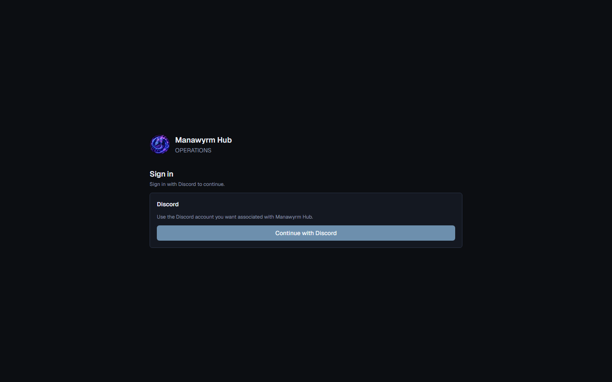

After signing in you land on the **Dashboard**, which shows what needs your attention. The side menu leads to **Runs**, **My Runs**, **Characters**, **Profile** and **Settings**. On a phone, open the same menu from the header. Raid Leads and Admins also see **Manage**.

## Characters

Your Characters belong to your account. Open **Characters**.

**Add a Character**

1. Choose **Add Character** and paste the Character's Raider.IO profile link. You can add up to 10 at once.
2. Class and item level are read from Blizzard and cannot be edited.
3. Choose the **specialization** and any other specs the Character can play. They decide which roles you can offer.

**Or connect Battle.net** (optional): choose **Connect** for EU or US, sign in at Battle.net, and import or link your Characters. Importing needs level 90 or higher. Connecting proves that the Character is yours. BoostingHub never stores your Battle.net login.

**Keep them up to date.** Data refreshes automatically about every two hours. **Refresh** or **Refresh all** does it right away. Item level never goes down on a refresh, so taking off a weapon does not lower it.

**Lockouts** show your raid progress for the current reset. They are information only and never stop you from signing up.

| Display | Meaning |
| --- | --- |
| `0/8` | Verified: nothing killed this reset |
| `3/8` | Verified: three bosses killed |
| `?` or Unknown | Not verified yet |
| Gray dot | Boss available, or unknown (hover for details) |
| Green dot | Boss killed |
| Red dot | Boss killed and the difficulty is fully saved |

**Deactivate** hides a Character from new Booster signups and can be undone. **Delete** is permanent and refused while the Character still has a signup on an unfinished Run.

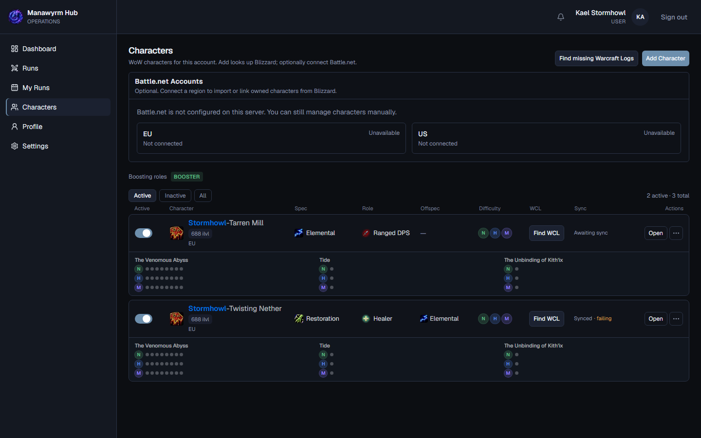

## Booster functions

**Booster** is a role on your account, granted by staff or through a Discord role. It covers every difficulty and all your eligible Characters. To apply, use **Apply via Discord** on the Characters page when it is shown.

A Character can be offered when it is yours and active, your account has the Booster role, and it has no conflict:

- **Weekly unavailable:** you marked it unavailable for this reset.
- **Schedule conflict:** the Character is on the roster of another Run that starts less than 2 hours from this one. Exactly 2 hours apart is allowed.

## Lootbuddies

Anyone can sign up as a Lootbuddy, with no Character and no special role. Choose a class and a mode:

- **Loot only**
- **Play along** (website only)

You can hold several Lootbuddy entries on a Run, and they can exist next to your Booster offers.

## Signups

A signup is an **offer**. **Signup does not mean selected**: the Raid Lead chooses the roster afterwards.

**On the website:** open **Runs** and choose **Sign up**. Booster and Lootbuddy sections save separately (**Save Booster Offers**, **Save Lootbuddies**). The website is best for choosing roles exactly.

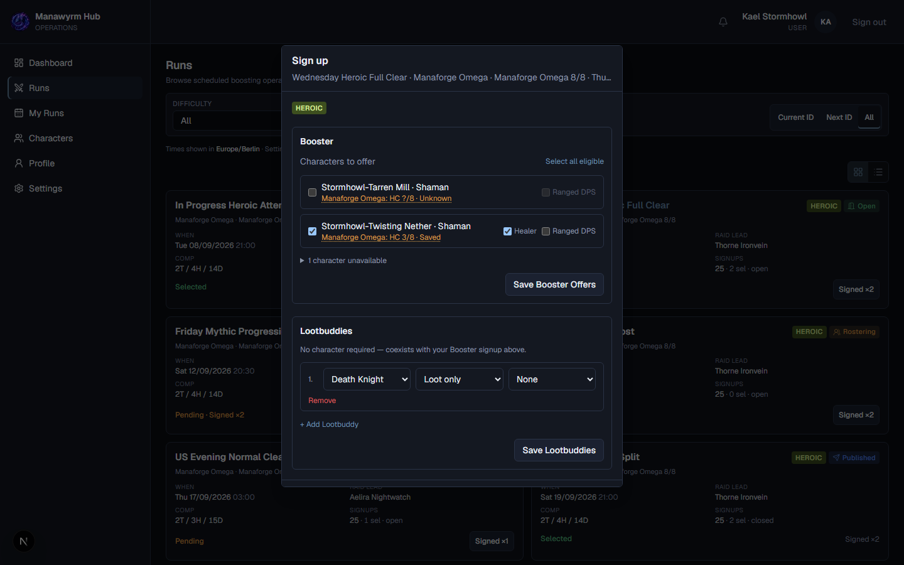

**In Discord:** each open Run has its own channel with a signup message:

| Button | What it does |
| --- | --- |
| **Signup** | Choose Characters, then the roles you offer, then confirm |
| **Quick Sign** | One click: offers all your eligible Characters with their default role. Keeps existing offers and skips Characters that are unavailable, in conflict, inactive or without a default role |
| **LB** | Lootbuddy signup: pick one or more classes (Loot only) |
| **Unsign** | Withdraws your Booster and Lootbuddy participation for this Run |
| **Add / Edit Note** | One short note for the Raid Lead (up to 100 characters) |

Use `/mysignups` in Discord for a quick private overview.

**Withdrawing.** A pending offer can be withdrawn on **My Runs** or with **Unsign**. If you are already picked, you must give a reason, and the Raid Lead is told. After the Run has started you can no longer withdraw; talk to your Raid Lead.

## Availability

On **Characters**, set the weekly **Availability** of each Character per difficulty for the current reset. An unavailable Character cannot be offered for that difficulty, and Quick Sign skips it. A pending offer alone does not reserve a Character; being picked for a Run does.

## My Runs

**My Runs** lists your signups by status. A raid-ID filter narrows the list.

| Status | Meaning |
| --- | --- |
| **Selected** | You are on the roster |
| **Pending** | You offered yourself and wait for the roster |
| **Not Selected** | You were not picked this time |
| **Withdrawn** | You left the offer |

If you are selected on a Run and still have other offers on it, they appear as pending alternatives.

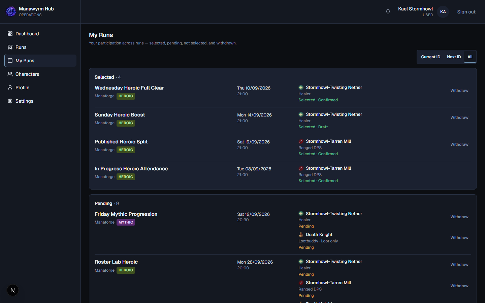

## Raid Lead functions

You manage Runs where you are the Raid Lead. Admins can manage every Run. Your **Dashboard** shows the next step of each Run, such as Build Roster, Start Run or Mark Attendance.

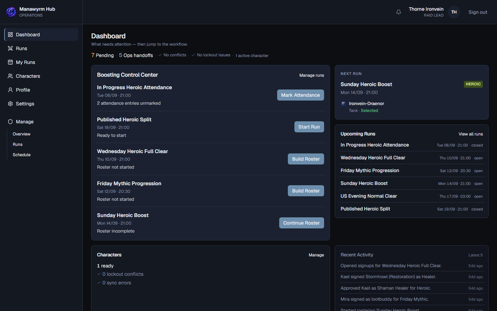

**Manage → Runs** lists your existing Runs with their status.

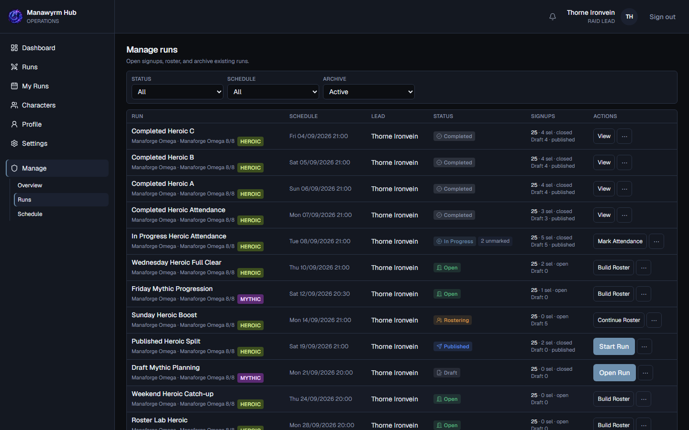

**Create a Run:** **Runs → Create Run**. You can create 1–25 drafts at once.

1. Set the shared defaults: **Product**, boss count, **Difficulty**, **Run type** (Saved, Unsaved, VIP or Community), composition, optional Discord role ping, notes. Mythic cannot use Saved.
2. Give each row a start time. Rows can override shared values.
3. Choose **Create N Draft(s)**. The title is generated automatically. Raid Leads always lead their own Runs; Admins choose a lead.

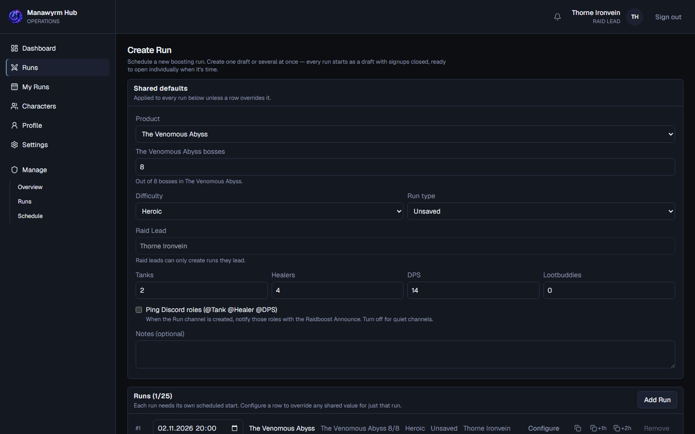

**Open and manage signups** on the Run page: **Open Run**, **Close / Reopen Signups**, **Edit Run** (until Start), **Cancel Run** (before Start; can be undone with **Reactivate Run**). Drafts stay hidden from normal users. Opening a Run creates its Discord channel once its raid week is current or next.

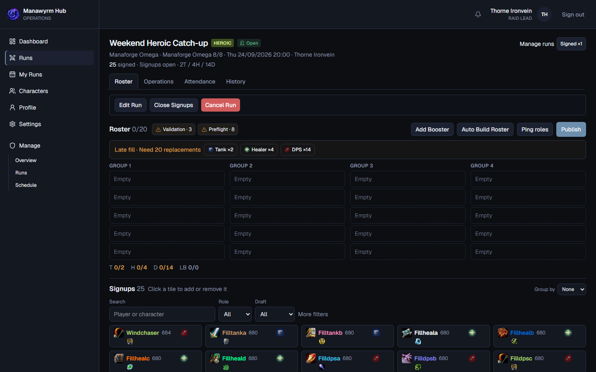

**Community Schedule** (**Manage → Schedule**) shows planned weekly times and their staffing. Raid Leads can read it; Admins change it.

## Runs and rosters

**Lifecycle:** Draft → Open → Rostering → Published → In Progress → Completed.

**Build the roster** on the Roster tab:

1. Review the offers and pick Characters with a **role**. Picks stay local until you choose **Save Roster**.
2. Add people if needed: **Add Booster** with **Registered player** for someone with an account, or **External** for someone without one.
3. Use **Auto Build Roster** if you like: **Fill gaps** keeps your picks, **Build from signups** proposes a full draft. Saved Characters are never auto-picked.
4. Watch composition and class buffs. A composition mismatch is a warning you can accept; a schedule conflict blocks the pick.
5. Choose **Publish Roster**. The Discord roster message updates in place.

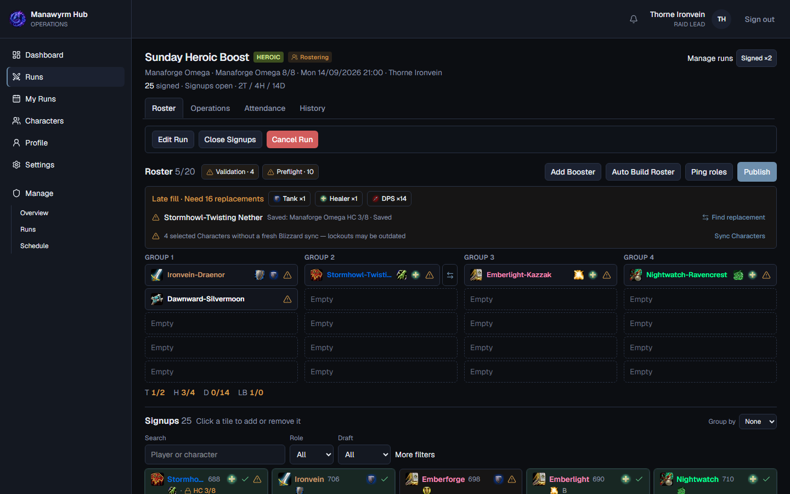

**After publishing** the roster stays editable until Start. Changes are published with **Update Roster**, and players are told only about what changed. Other useful tools:

- **Find replacement** suggests people from the current signups for a problem slot.
- **Ping roles** asks Discord for missing roles or sends your own short request, at most once per 30 minutes per role.
- **Sync Characters** refreshes picks that have no fresh data.

**Start Run** closes signups, freezes the roster and creates the attendance list. Run the checklist first: **Start will be refused** items must be fixed, **Check before starting** items are your call. Players get a Raid Invite and the Discord channel gets the Final Setup post.

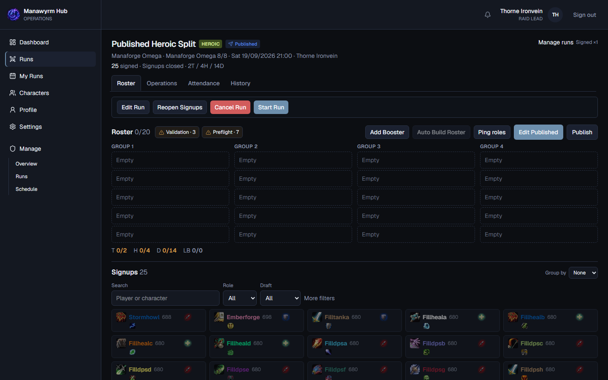

**Attendance:** mark Present, Late, Left early, No show, Excused or Standby. **Mark all unmarked as Present** helps at the end. Use **Replace** for someone who did not show up; the replacement is added to the Run. **Complete Run** needs every row marked.

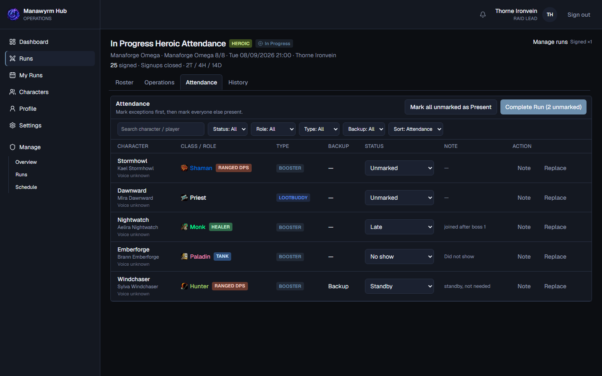

**After completion** attendance is read-only. Later mistakes are fixed with **Correct Attendance**, which needs a reason and is recorded. The **Consumables** tab shows Warcraft Logs facts about consumables, gear and deaths. It is filled automatically about 15 minutes after completion when a log is available; you can also paste a report link. It lists facts and warnings, never a score. **Archive** keeps the Run and removes its Discord channel after saving a transcript.

## Admin functions

Admins and the Owner can do everything Raid Leads do, on every Run, plus:

| Area | Where | What |
| --- | --- | --- |
| Users | **Manage → Users** | Search users, change account roles, grant or revoke Booster and Lootbuddy, review old pending requests, add or revoke Strikes |
| Characters | **Manage → Characters** | Check sync health of all Characters, sync or force-refresh, delete |
| Schedule | **Manage → Schedule** | Plan weekly times and Run Setups, attach existing Runs, create Drafts early. Automatic Drafts are released Mondays at 12:00 for the raid ID starting that Wednesday |
| Raid Catalog | **Manage → Raid Catalog** | Import raids and seasons from Blizzard, manage products, archive raids |
| Analytics | **Manage → Analytics** | Operational numbers |
| System | **Manage → System** | Status of integrations and backups |

The last active Admin cannot be removed, and the Owner role is protected.

**Strikes** are a disciplinary record on a user, never created automatically. Users see their own Strikes on **Profile**, without staff notes. Raid Leads can add one from the Signups tab of a Run they manage; only Admins can add a general Strike or revoke one.

## Discord notifications and commands

Everything also appears in the bell and on **Notifications** in the app. Discord DMs follow your settings.

| Message | When |
| --- | --- |
| Roster Selected, Roster Update, Roster removed | You are picked, your Character changes, or you are taken off |
| Raid Invite | The Run starts and you are selected |
| Run Cancelled, Reactivated | The Run is cancelled or restored |
| Run Rescheduled, Run Updated | Start time or raid content changes |
| Character saved | Your picked Character got saved on a planned boss |
| Boss Plan Update | Your boss plan changes, where boss exceptions are enabled |
| Roster Withdrawal (Raid Lead) | A picked player withdraws, with the reason |

**Run channels** hold the signup message, the Roster message, the Final Setup after Start and announcements about changes. Channel messages do not depend on your DM settings. The channels `#current-id` and `#next-id` hold the Schedule of the current and next raid week. Raid weeks change Wednesdays at 06:00 Europe/Berlin.

For DMs to arrive you must share the Discord server with the bot and allow DMs from server members.

**Commands:** `/mysignups` shows your signups, `/guide booster` and `/guide raidlead` link to the guide channels.

## Settings and profile

**Settings:**

- **Notifications:** a master switch and one switch per DM type, plus **Quiet Hours** that delay personal DMs. Channel messages are never delayed.
- **Regional:** your time zone for personal displays. Run titles and Discord channel names always use Europe/Berlin.
- **Gameplay:** your Default Character. It only preselects; it never bypasses a rule.
- **Active sessions:** see and sign out your devices.

**Profile** shows your account, Boosting Roles and Strikes.

## Glossary

| Term | Meaning |
| --- | --- |
| Run | One planned raid |
| Raid ID / reset | The weekly raid lockout period |
| Saved | The Character already killed bosses this reset |
| Offer | A Character you signed up on a Run |
| Roster | The people the Raid Lead picked |
| Run type | Saved, Unsaved, VIP or Community |
| Lootbuddy | Participant who comes for loot, not as a Booster |
| External Booster | Helper without an account, added by hand |
| Run Setup | Reusable preset for what a Run contains |
